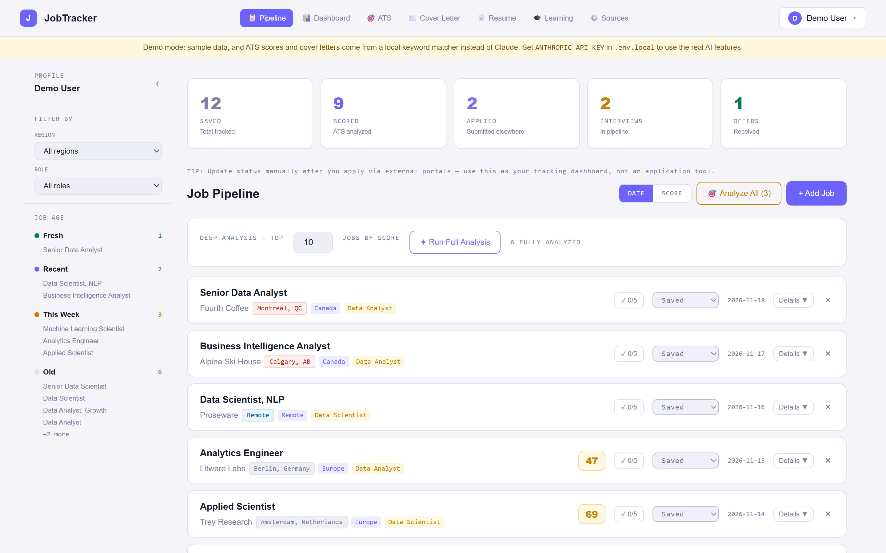
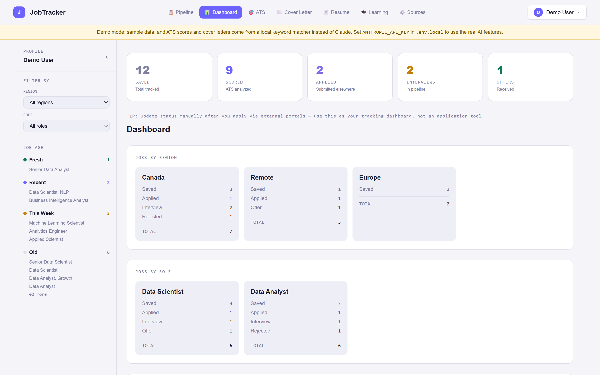
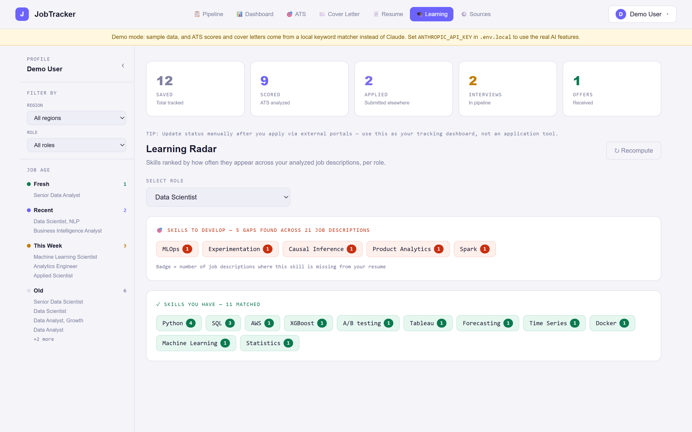

# JobTracker: local-first job search dashboard with AI resume matching

A self-hosted job search tool built with Next.js and the Claude API. It pulls postings from public job boards, scores each one against your resume, shows which skills you keep missing, and drafts tailored cover letters. Everything is stored as JSON on your own machine, with no cloud database.

**Runs without an API key.** With no key set, the app starts in demo mode with sample data and a local keyword matcher, so you can try every screen for free.



## Features

| Area | What it does |
|---|---|
| **Pipeline** | Track jobs through Saved, Applied, Interview, Offer and Rejected, with per-job checklists, notes and region/role tags |
| **Job scraping** | Pulls postings from Remotive, Arbeitnow, The Muse, Adzuna, and company Greenhouse/Lever boards or career pages |
| **Full descriptions** | Fetches the full posting from the job URL (with Greenhouse/Lever/generic parsers) when an API only returns a snippet |
| **ATS fit scoring** | Claude scores each job 0 to 100 against your resume and lists matched and missing keywords |
| **Top-K deep analysis** | Runs a detailed review on your K best-scoring jobs: rewritten summary and section-by-section suggestions |
| **PDF export** | Exports a job's analysis, suggestions and description as a formatted PDF |
| **Learning Radar** | Aggregates missing skills across every analyzed job, per role, so you can see which gaps matter most |
| **Cover letters** | Generates a tailored three-paragraph cover letter from your resume and the posting |
| **Multiple resumes and personas** | Keep separate resumes per role/region and switch between profiles |
| **Duplicate protection** | Recognises the same posting across re-listings and sources, and merges existing duplicates with a backup |

## Data quality

Job boards often re-list the same posting under a new ID, with tracking parameters in the URL, so matching on URL alone lets duplicates through. `lib/jobs.ts` gives every posting a **canonical key**: normalised company (accents, punctuation and legal suffixes such as Inc/Ltd/GmbH removed) plus normalised title (gender tags such as "(m/f/d)" removed). URLs are compared after stripping `utm_*` and similar tracking parameters.

- **On scrape:** jobs with a missing title or company are dropped, fields are cleaned (HTML entities, stray labels such as "Description Chubb" become "Chubb"), and anything matching an existing key or URL is skipped. The result shows how many were skipped and why.
- **On manual add:** the API rejects a job that is already tracked (HTTP 409) and names the existing entry.
- **Existing data:** when duplicates are present, a "Merge N duplicates" button appears in the pipeline. Merging keeps the most advanced record (furthest status, then analysed, then scored), fills gaps from the others (longest description, notes, checklist progress, earliest first-seen date), writes `jobs.backup-<timestamp>.json` first, and rebuilds the Learning Radar.
- **Applied date:** set automatically the first time a job moves past "saved".

| Dashboard | Learning Radar |
|---|---|
|  |  |

## Quick start

Requires Node.js 18+.

```bash
git clone <this-repo-url> job-tracker
cd job-tracker
npm install
npm run dev
```

Open http://localhost:3000. With no `.env.local`, the app runs in **demo mode**.

### Using the real AI features

```bash
cp .env.example .env.local
# then set ANTHROPIC_API_KEY in .env.local
```

Restart `npm run dev`. Your own data is stored in `data/`, which is gitignored and separate from the demo data. Then:

1. **Resume** tab: paste your resume as plain text.
2. **Sources** tab: set keywords and job sources, then click Scrape Now (or add jobs by hand with + Add Job).
3. **Pipeline** tab: click Analyze All to score jobs, then Run Full Analysis on the top K.
4. **Learning** tab: see which skills come up most often as gaps.
5. **Cover Letter** tab: pick a tracked job and generate a draft.

Scoring uses Claude Haiku. A typical analysis costs a fraction of a cent.

## Demo mode

Demo mode is on when `ANTHROPIC_API_KEY` is empty, or when `DEMO_MODE=true`.

- Data is copied from `sample-data/` (fictional companies and a fictional resume) into `.demo-data/` on first run, with dates shifted so the newest job is today. Delete `.demo-data/` to reset it.
- Any tab can be opened directly with `?tab=`, for example http://localhost:3000/?tab=learning.
- ATS analysis and cover letters come from `lib/demo.ts`: a deterministic keyword matcher and a template. They show how the app works but are not real model output. A banner in the UI says so.
- Job scraping still works in demo mode, because the job board APIs it uses are public (Adzuna needs its own free key).

## Architecture

```
app/
  page.tsx                   Single-page UI (pipeline, dashboard, ATS, cover letter, resume, learning, sources)
  api/
    jobs/                    CRUD for tracked jobs (validates and rejects duplicates)
    jobs/dedup/              Count (GET) or merge (POST) duplicates, with backup
    analyze/                 ATS scoring via Claude (or the demo matcher)
    coverletter/             Cover letter generation via Claude (or the demo template)
    scrape/, scrape/config/  Run scrapers, read/write scraper settings
    fetch-description/       Fetch and parse a full posting from its URL (cheerio)
    export/pdf/              Build a PDF report for one job (pdfkit)
    resume/, resumes/        Resume storage
    personas/, regions/, roles/
lib/
  storage.ts                 JSON file storage, per persona, plus Learning Radar aggregation
  scraper.ts                 Job board and company-board scrapers
  jobs.ts                    Canonical job key, URL normalisation, field cleanup, duplicate merging (pure functions)
  demo.ts                    Demo-mode switch, mock analyzer and cover letter template
sample-data/                 Fictional data used in demo mode
scripts/                     Optional Windows/WSL auto-start with PM2
```

Storage is plain JSON files under `data/personas/<id>/` (jobs, resumes, regions, roles, learning, scraper config). There is no database or auth, because the app is meant to run locally for one person.

**Stack:** Next.js 14 (App Router), React 18, TypeScript, Tailwind, Anthropic SDK, cheerio, pdfkit.

## Why there is no hosted demo

The app writes to JSON files on local disk and has no authentication, so it is built to run on your own machine. Serverless hosts such as Vercel have a read-only or temporary filesystem, so saving jobs would fail there, and a public deployment with an API key would let anyone spend that key. Run it locally (demo mode needs no key) instead.

## Running in the background (optional, WSL2 on Windows)

`ecosystem.config.js` runs the app under [PM2](https://pm2.keymetrics.io/). `scripts/setup-windows-autostart.ps1` registers a Windows Task Scheduler job that starts it at login. Pass `-AppDir` with the project's path inside WSL.

## Roadmap

- ~~Canonical-key deduplication of scraped postings, and field validation~~ (done)
- Structured multi-criteria fit rubric (skills, seniority, location, deal-breakers)
- Drafter and reviewer passes for cover letters
- Guard against hidden text and prompt injection in scraped postings
- Unit tests and CI

## Privacy

Your resume and job data never leave your machine except in the requests sent to the Claude API for analysis. `data/`, `.demo-data/` and `.env.local` are all gitignored.
